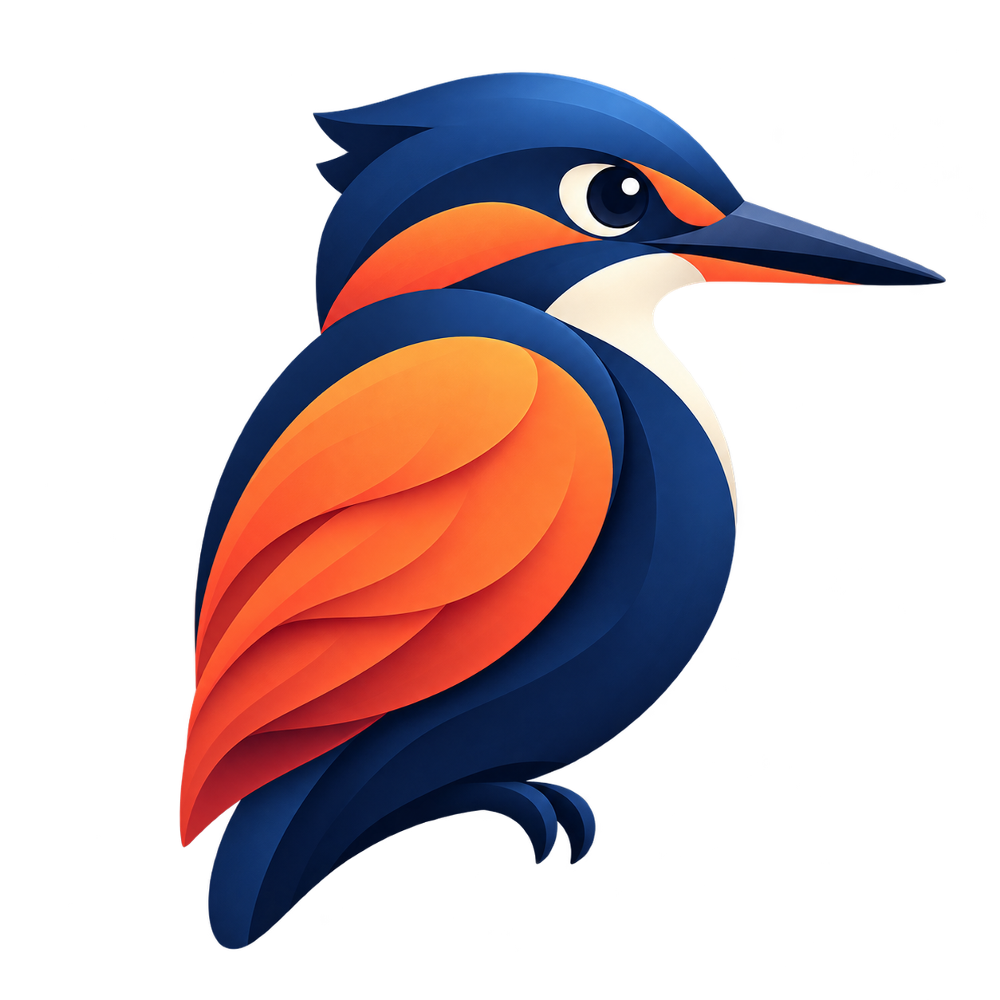

<p align="center">
  
</p>

# Bildblick

**Bilder ansehen, schnell bearbeiten und gezielt exportieren – direkt auf deinem Linux-Desktop.**

Bildblick ist eine lokale Desktop-Anwendung mit GTK 4. Du kannst durch Bildordner blättern, Bilder zuschneiden oder skalieren, Farben anpassen und Ergebnisse mit passenden Formatoptionen speichern. Für wiederkehrende Aufgaben gibt es Stapelverarbeitung, benannte Exportprofile und eine Kommandozeilenschnittstelle.

Die Oberfläche folgt der Systemsprache und ist auf Deutsch und Englisch verfügbar. Mit `BILDBLICK_LANGUAGE=en` oder `BILDBLICK_LANGUAGE=de` lässt sich die Sprache beim Start festlegen. Ein Konto oder Cloud-Dienst ist für die Bildbearbeitung nicht erforderlich.

**Stand: 0.11.0 · frühe Version · MIT-Lizenz · Referenzsystem: Fedora 44**

## Inhalt

- [Funktionen](#funktionen)
- [Installation](#installation)
- [Erste Schritte](#erste-schritte)
- [Tastenkürzel](#tastenkürzel)
- [Größe ändern](#größe-ändern)
- [Speichern und Exportprofile](#speichern-und-exportprofile)
- [Stapelverarbeitung und CLI](#stapelverarbeitung-und-cli)
- [Formate und Mehrseiten-Dateien](#formate-und-mehrseiten-dateien)
- [Datenspeicherung und Grenzen](#datenspeicherung-und-grenzen)
- [Entwicklung und Tests](#entwicklung-und-tests)
- [Fehler melden und mitarbeiten](#fehler-melden-und-mitarbeiten)

Das [Produktdokument](PRODUCT.md) beschreibt Zielgruppe, Bedienkonzept, Produktumfang und nächste Entwicklungsschritte.

## Funktionen

| Bereich | Verfügbar |
| --- | --- |
| Anzeige | Zoom, Einpassen, 100-%-Ansicht, Vollbild, Transparenzraster |
| Navigation | Ordner öffnen, natürlich sortierte Dateinamen, Vorschaubilder, Namensfilter |
| Bearbeitung | Freie Drehung, Spiegeln, präzise Auswahl, Zuschneiden, Pixel/Prozent/cm/Zoll/DPI, Rückgängig und Wiederholen |
| Farben und Details | Gamma, RGB-Balance, Helligkeit, Kontrast, Sättigung, Rote Augen, Histogramm, Farbkanäle, Palette und zehn Effekte |
| Ergänzungen | Text im Auswahlrahmen mit Schriftwahl, Zeichnen, Rahmen, Leinwand, Bildwasserzeichen, Panorama |
| Export | Formatwahl, JPEG-/GIF-/PNG-/WebP-Optionen, Metadaten-Schalter, Profile |
| Serien | Stapelkonvertierung, skalierte Ausgaben, umbenannte Kopien, Vorschau und Abbruch |
| Mehrere Seiten | Seiten-/Framewechsel, Animation, Export nach TIFF, GIF, WebP oder PDF |
| Desktop | Anwendungsmenü, Zwischenablage, mehrere Fenster, Dateiaktionen, eigene Druckgröße und Position |
| Optionale Systemfunktionen | Scannen über SANE; Audio/Video über GTK/GStreamer |
| Automatisierung | CLI mit JSON-Ergebnis, Vorschau und Fehlerstatus |

Die Druckanbindung ist implementiert; eine physische Druckausgabe wurde bislang nicht bestätigt. Die zentralen grafischen Abläufe werden zusätzlich in einer GTK-Sitzung in GitHub Actions geprüft. Details zum Teststand findest du unter [Entwicklung und Tests](#entwicklung-und-tests).

## Installation

### Voraussetzungen

Bildblick benötigt eine grafische Linux-Sitzung und folgende Systembibliotheken:

| Komponente | Zweck |
| --- | --- |
| `/usr/bin/python3` | Anwendung und Installer ausführen |
| GTK 4 und PyGObject | Native Fenster und Dialoge |
| Pycairo | Bildfläche und Druckanbindung |
| Pillow ab Version 12 | Bildoperationen und Standard-Codecs |
| GdkPixbuf | Darstellung von Bilddaten und Symbolen |
| Fontconfig (`fc-match`) und installierte Schriften | Schriftfamilien und Stile für eingefügten Text |

Auf dem Referenzsystem wurden Python 3.14, GTK 4.22 und Pillow 12.3 verwendet. Andere Distributionen können funktionieren, sind jedoch noch nicht als vollständige Konfiguration geprüft.

Fedora-Pakete für die Grundausstattung:

```bash
sudo dnf install python3 python3-gobject python3-cairo python3-pillow gtk4 fontconfig
```

Zusätzliche Formate nutzen optional installierte Decoder:

```bash
sudo dnf install ImageMagick poppler-utils ffmpeg-free util-linux
```

Scannen benötigt zusätzlich `sane-backends` und einen eingerichteten Scanner. Die Medienwiedergabe benötigt das GTK-Medienbackend und passende GStreamer-Codecs. Beides ist optional; die App meldet fehlende Unterstützung.

Die Ausgabeformate und Zusatzdecoder hängen von den tatsächlich vorhandenen Codec-Builds ab. Der Installer lädt keine Abhängigkeiten herunter und installiert keine Systempakete.

### Fertiges Paket installieren

#### Für Ubuntu und andere Linux-Distributionen (empfohlen)

Die Flatpak-Version bündelt die Bildverarbeitungsabhängigkeit und nutzt eine gemeinsame GTK-Laufzeit. Damit musst du Python, GTK und Pillow nicht selbst über den Paketmanager deiner Distribution einrichten.

1. Flatpak installieren und Flathub aktivieren (auf Ubuntu meist über die Software-App oder die [Flatpak-Anleitung](https://flatpak.org/setup/)).
2. `Bildblick-0.11.0.flatpak` aus den [GitHub-Releases](https://github.com/obaidr1/obiview/releases) herunterladen.
3. Die Datei mit der Software-App öffnen oder im Download-Ordner ausführen:

```bash
flatpak install --user ./Bildblick-0.11.0.flatpak
```

Bildblick erscheint danach im Anwendungsmenü. Beim ersten Start gewährt die Dateiauswahl Zugriff auf die von dir geöffneten Bilder und Ordner. Die erste Flatpak-Veröffentlichung ist für x86-64-PCs gebaut; andere Architekturen sind noch nicht enthalten.

#### Manuelle Systeminstallation

1. `Bildblick-0.11.0-linux.tar.gz` aus den [GitHub-Releases](https://github.com/obaidr1/obiview/releases) herunterladen.
2. Archiv entpacken.
3. Im entpackten Ordner `install.sh` ausführen.
4. Im Anwendungsmenü nach **Bildblick** suchen.

```bash
tar -xzf Bildblick-0.11.0-linux.tar.gz
cd Bildblick-0.11.0
./install.sh
```

Die Installation erfolgt im eigenen Benutzerkonto und benötigt kein `sudo`. Ein vorhandener Standard-Bildbetrachter bleibt unverändert. Bildblick wird zusätzlich als Anwendung unter **Öffnen mit** angeboten. Diese Variante benötigt weiterhin die oben beschriebenen Systemabhängigkeiten.

Das Archiv enthält Anwendungscode, Dokumentation und Symbol. Die Python-/GTK-Laufzeit wird vom System bereitgestellt; das Paket ist kein eigenständiges AppImage.

### Aus dem Quellcode starten oder installieren

Im Projektverzeichnis:

```bash
./start.sh
./start.sh /pfad/zum/bild.jpg
./start.sh /pfad/zum/bildordner
```

Für einen dauerhaften Menüeintrag:

```bash
/usr/bin/python3 packaging/install.py --source .
```

Nach einer Aktualisierung eine laufende Instanz schließen und Bildblick erneut über das Anwendungsmenü öffnen. Änderungen im Quellcodeverzeichnis werden erst nach erneutem Installieren in die installierte Kopie übernommen.

### Installationsorte

| Inhalt | Standardpfad |
| --- | --- |
| Anwendungsdateien | `~/.local/share/bildblick/app/` |
| Terminal-Starter | `~/.local/bin/bildblick` |
| Menüeintrag | `~/.local/share/applications/io.github.obaidr1.obiview.desktop` |
| Symbol | `~/.local/share/icons/hicolor/scalable/apps/io.github.obaidr1.obiview.svg` |
| Exportprofile | `~/.config/bildblick/save-profiles.json` |
| Ansichtsoptionen | `~/.config/bildblick/viewer.json` |
| Die letzten zehn Bildordner | `~/.config/bildblick/recent.json` |

`XDG_DATA_HOME` und `XDG_CONFIG_HOME` werden für die entsprechenden Daten- und Konfigurationsorte berücksichtigt. Der Terminal-Starter liegt unabhängig davon unter `~/.local/bin`.

Zur Deinstallation die oben genannten Anwendungsdateien, den Starter, Menüeintrag und das Symbol entfernen. Exportprofile können separat aufbewahrt werden. Eigene Bilddateien liegen außerhalb der Installation.

## Oberfläche und Bildanpassungen

**Einheitliche Bearbeitungsdialoge:** Helligkeit/Kontrast/Farbe, Schärfen/Weichzeichnen, freie Drehung, Rahmen, Rote Augen, Farbreduktion, Farbkanaltausch, automatischer Zuschnitt, Leinwand und Text bieten eine große Live-Vorschau mit Originalvergleich, Zurücksetzen, Anwenden und Abbrechen. Stärke, Kontrast, Sättigung, Schärfe, Winkel, Toleranz und Farbanzahl werden mit Slidern eingestellt. Rahmenstile, Farbkanal-Reihenfolgen und Zeichenwerkzeuge stehen als direkte Schaltflächen bereit. Änderungen werden erst beim Anwenden als ein Undo-Schritt übernommen.

Bei Rahmen- und Strichbreiten ergänzt eine genaue Zahleneingabe den Slider. Bildmaße, DPI, Positionen und Dateinamen bleiben präzise Eingabefelder. Einheiten, Interpolation, Größenvorgaben, Auswahlverhältnisse, Druckmodi und weitere Exportformate sind direkt anklickbar. PNG-Kompression und die Qualität in Export- und Stapeloptionen verwenden ebenfalls Regler.

Die neuen Werkzeugvorschauen werden im Hintergrund aus den Originalpixeln berechnet und anschließend für die Anzeige verkleinert. Bei großen Bildern kann die Berechnung länger dauern. Ein Klick auf Anwenden während der Berechnung wartet auf die aktuelle, gültige Vorschau; Abbrechen bleibt möglich. Veraltete Ergebnisse werden verworfen. Der bestehende Effekte-Dialog und die Bildanpassungen nutzen weiterhin verkleinerte Arbeitsvorschauen.

Bildblick verwendet eine helle, monochrome Oberfläche mit abgerundeten Karten und schwarzen Hauptaktionen. Das Hauptfenster startet mit **720 × 640 Pixeln**. Eine sichtbare Menüleiste und eine einzelne kompakte Symbolleiste stehen oberhalb der Bildfläche; die Statuszeile liegt unten. Öffnen, Speichern, Ausschnitt, Historie, Bildinformationen, Zoom, Navigation, Größenänderung und Bildanpassungen sind direkt erreichbar. Die Bildfläche enthält keine schwebenden Bedienelemente oder Bearbeitungsleiste.

- **Looks:** Original, Film, Fade und Warm.
- **Licht:** RGB-Histogramm, Helligkeit, Kontrast, Gamma, Lichter und Schatten.
- **Farbe:** Temperatur, Sättigung, Dynamik sowie Rot-, Grün- und Blau-Balance.
- **Effekte:** Körnung, Vignette und Schärfe.

**Bild → Bildanpassungen** oder das Einstellungs-Symbol öffnet einen eigenen Dialog mit Bildvorschau, Looks und Reglern. Auch Vorschaubilder öffnen sich in einem separaten Fenster. Regler zeigen zunächst eine Vorschau. **Anwenden** übernimmt sie als rückgängig machbaren Bearbeitungsschritt; **Zurücksetzen** verwirft die Vorschau. Speichern und weitere Bildoperationen übernehmen offene Anpassungen vor ihrer Ausführung. Die Vorschau ist für schnelle Rückmeldung verkleinert; beim Anwenden wird das Bild in voller Auflösung verarbeitet. Das Histogramm basiert auf dem Vorschaubild und dient zur Orientierung.

Die Menüleiste enthält **Datei**, **Bearbeiten**, **Bild**, **Ansicht**, **Extras** und **Hilfe**. Die wichtigsten Aktionen besitzen Tastenkürzel; die Tabelle unten nennt die aktuelle Zuordnung. Die Oberfläche verwendet ausdrücklich das helle Erscheinungsbild; ein separates dunkles Design ist nicht enthalten.

## Erste Schritte

1. **Bild öffnen:** `Strg+O` verwenden oder eine einzelne Datei ins Fenster ziehen.
2. **Ordner durchsuchen:** Über **Datei → Ordner öffnen** einen Bildordner wählen. Vorschaubilder lassen sich im Menü **Ansicht** einblenden und nach Dateinamen filtern.
3. **Ansicht einstellen:** Mit `F` an den Desktop anpassen, mit `Strg+H` auf 100 % wechseln oder mit `+` und `−` zoomen.
4. **Bearbeiten:** Eine Auswahl aufziehen und zuschneiden, das Bild drehen oder mit `Strg+R` die Pixelgröße ändern.
5. **Speichern:** Mit `Strg+Umschalt+S` Dateiname, Zielordner, Format und Optionen festlegen.

Beim Wechseln zu einem anderen Bild oder beim Schließen fragt Bildblick nach, wenn ungespeicherte Änderungen vorhanden sind. Speichern erfolgt erst durch eine ausdrückliche Speicheraktion.

## Bildinformationen

**I** oder **Bild → Bildinformationen** öffnet die Datei- und Bildübersicht: Dateiname, Verzeichnis, voller Pfad, Format, getrennte X-/Y-DPI, ursprüngliche und aktuelle Abmessungen mit Megapixeln und Seitenverhältnis, Druckmaße in cm und Zoll, ursprüngliche und aktuelle Farbtiefe, gezählte RGB-Farben, Dateigröße, Speicherbedarf der aktuellen Pixel, Ordnerposition, Änderungsdatum, Ladezeit und Seite/Frame.

Die Farbzählung läuft im Hintergrund und lässt sich abschalten; unterschiedliche Alpha-Werte werden nicht als zusätzliche RGB-Farben gezählt. Der angegebene Pixel-Speicher umfasst weder den gesamten Prozess noch die Undo-Historie. Fehlende Quelldaten werden als nicht verfügbar gekennzeichnet; bei extern gerasterten Formaten wird keine ursprüngliche Farbtiefe erfunden.

**Ändern** übernimmt X-/Y-DPI ohne Änderung der Pixelzahl, mit Rückgängig. Fehlt eine gültige Auflösung, wird die angenommene Vorgabe 96 DPI gekennzeichnet. EXIF, IPTC und Kommentare haben eigene Leseansichten. Das ist kein vollständiger Metadateneditor; insbesondere ist eine vollständige IPTC-Erhaltung beim Export nicht zugesichert.

## Tastenkürzel

Die [vollständige Belegung](docs/SHORTCUTS.md) ist in der App über **F1** durchsuchbar. Im Zoom scrollen Pfeiltasten das Bild, sonst wechseln sie die Datei.

| Kürzel | Aktion |
| --- | --- |
| `O`, `Strg+O` | Bild öffnen |
| `S`, `Strg+Umschalt+S` | Speichern unter |
| `Strg+S` | Speicherdialog öffnen |
| `Strg+R` | Größe ändern |
| `I` | Bildinformationen |
| `Strg+Z` / `Strg+Umschalt+Z` | Rückgängig / Wiederholen |
| `Strg+Y` | Auswahl zuschneiden |
| `Strg+C` / `Strg+V` | Auswahl oder ganzes Bild kopieren / Bild als neues Dokument einfügen |
| `Strg+X` / `Strg+A` | Auswahl ausschneiden / alles auswählen |
| `Umschalt+C` | Eigene Auswahl |
| `Umschalt` + Pfeiltasten | Auswahl um einen Pixel verschieben |
| `Strg+T` | Text in die Auswahl einfügen |
| `Strg+N` | Arbeitsbild in neuem Fenster öffnen |
| `D` | Bild vom Bildschirm entfernen, Datei behalten |
| `Umschalt+R` | Gespeicherte Datei erneut öffnen |
| `Strg+F` | Dateinamen in den Vorschaubildern suchen |
| `F2` | Datei umbenennen |
| `F12` | Zeichnen |
| `Strg+P` | Drucken |
| `R` | 90° im Uhrzeigersinn drehen |
| `+` / `−` | Vergrößern / Verkleinern |
| `F` / `Strg+H` | Desktop-/Fensteranpassung / 100 % |
| `←` / `→` | Vorherige / nächste Datei im Ordner |
| `Strg+Bild auf` / `Strg+Bild ab` | Vorherige / nächste Seite oder Frame |
| `Esc` | Auswahlmodus verlassen |
| `F5` / `F9` | Ansicht aktualisieren / Diashow starten oder stoppen |
| `Enter` | Vollbild umschalten |
| `F11` | Vollbild öffnen; darin Mauszeiger umschalten |
| `F1` | Durchsuchbare Tastaturhilfe |

## Größe ändern

**Bild → Größe ändern**, der sichtbare Größen-Button und `Strg+R` öffnen denselben Dialog.

- Breite und Höhe lassen sich in **Pixeln**, **Prozent**, **Zentimetern** oder **Zoll** eingeben.
- Bei aktiviertem Seitenverhältnis passt die Änderung eines Feldes das andere an.
- Prozentwerte beziehen sich auf die Bildgröße beim Öffnen des Dialogs.
- Vorlagen bieten 25, 50, 100 und 200 Prozent; weitere Werte können direkt eingegeben werden.
- Auflösungsvorgaben reichen von 640 × 480 bis 3840 × 2160 sowie Bildschirmgröße. Bei gesperrtem Verhältnis wird das Bild in diese Abmessungen eingepasst.
- **DPI** bestimmt die physische Druckgröße. Eine reine DPI-Änderung bei unveränderten Pixelmaßen erzeugt keine Details und ist rückgängig machbar. JPEG, PNG, TIFF, BMP und PDF erhalten die Druckauflösung beim Export. Die technische Druckauflösung bleibt auch bei deaktivierten privaten Metadaten erhalten.
- Als Interpolation stehen Lanczos, bikubisch, bilinear und nächster Nachbar bereit.
- Die Zielgröße und Megapixelzahl werden vor dem Anwenden angezeigt.

Die Größenänderung verändert den Bearbeitungsstand und kann rückgängig gemacht werden. Eine Änderung des Zoomfaktors verändert dagegen nur die Ansicht.

## Auswahl, Korrekturen und Ergänzungen

Ein Rechteck lässt sich direkt mit der linken Maustaste aufziehen. Ziehen an Kanten oder Ecken ändert es; die rechte Maustaste verschiebt es innerhalb des Bildes. **Bearbeiten → Eigene Auswahl** bietet Position, Pixel-/cm-/Zoll-Maße, DPI und feste Seitenverhältnisse. Bei festem Verhältnis bestimmt die Breite die Höhe. **Auswahl maximieren und zentrieren** vergrößert den Ausschnitt mit seinem Verhältnis bis zum Bildrand.

**Strg+C** kopiert die Auswahl, ohne Auswahl das ganze Bild. **Datei → Neues Fenster**, danach **Strg+V**, erzeugt daraus ein separat speicherbares Dokument. **Strg+X** kopiert die Auswahl und ersetzt deren Pixel durch Weiß. **Außerhalb der Auswahl löschen** erhält die Leinwandgröße und füllt die Umgebung weiß. **Einfarbige Ränder entfernen** erkennt transparenten Rand oder die Hintergrundfarbe oben links; die Toleranz ist einstellbar.

**Bild → Frei drehen** verwendet Gradangaben, positive Werte im Uhrzeigersinn. Erweiterte Bildfläche und Randfarbe sind wählbar. **Rote Augen korrigieren** benötigt eine enge Auswahl um das Auge und verändert nur rot dominierte Pixel darin.

**Effekte** enthält 3D-Schaltfläche, Weichzeichnen, Relief, Ölgemälde, Kantenerkennung, Median, Explosion, Pixelieren, Sepia und Regentropfen. Alle zehn Effekte sind direkt über eigene Schaltflächen auswählbar, ohne Dropdown. Eine große Live-Vorschau zeigt die Änderungen. Der Intensitätsregler mischt jeden Effekt mit dem Original; je nach Effekt kommen Regler für Radius, Randbreite, Pixelgröße, Streuung oder Tropfenpaare hinzu. „Original vergleichen“ zeigt das unveränderte Bild. Einstellungen bleiben beim Wechsel zwischen Effekten erhalten. „Effekt zurücksetzen“ setzt den ausgewählten Effekt zurück. Erst „Anwenden“ übernimmt ihn in voller Auflösung als einen rückgängig machbaren Schritt; „Abbrechen“ verwirft die Vorschau. Bei großen Bildern ist die Vorschau verkleinert und kann bei pixelabhängigen Effekten vom Ergebnis in Originalauflösung abweichen. **Farben reduzieren** bietet 2–256 Farben und Dithering. **Farbkanäle tauschen** vertauscht RGB-Kanäle; ein eigener Histogrammdialog zeigt die volle Bildverteilung.

**Rahmen hinzufügen** bietet einfache, doppelte und plastische Rahmen mit Breiten und Farbauswahl. **Leinwand erweitern** stellt jede Seite getrennt ein: positive Werte fügen Fläche hinzu, negative schneiden Rand ab. **Bilder zusammenfügen** setzt mehrere Bilder horizontal oder vertikal mit Abstand zusammen; es ist keine perspektivische Panoramaverschmelzung.

**Text einfügen** verwendet die gewählte Schriftfamilie, Schriftstil, Punktgröße und Farbe. Text wird innerhalb der Auswahl umgebrochen und begrenzt. Ohne Auswahl beginnt er mit 20 Pixel Abstand oben links. Die Umrechnung von Punkt in Pixel berücksichtigt die Bild-DPI. **Bearbeiten → Zeichnen** öffnet einen eigenen Dialog für Stift, weichen Pinsel, Linie, Pfeil, Rechteck und Ellipse. Alle sechs Werkzeuge haben eigene Symbole und Textbeschriftungen. Einzelne Striche können dort zurückgenommen werden; Anwenden erzeugt einen gemeinsamen Undo-Schritt.

## Dateien, Ansicht und Druck

Das Datei-Menü enthält **Erneut öffnen**, **Öffnen mit**, **Dateien suchen**, **Letzte Ordner**, **Umbenennen**, **Kopieren**, **Verschieben** und **In den Papierkorb**. Dateiaktionen verwenden gespeicherte Dateien; offene Änderungen müssen zuerst gespeichert oder rückgängig gemacht werden. Kopieren, Verschieben und Umbenennen überschreiben kein vorhandenes Ziel. Löschen fragt nach und verwendet ausschließlich den System-Papierkorb.

Unter **Extras → Ansicht einstellen** sind die Hintergrundfarbe und das Vergrößern kleiner Bilder beim Einpassen konfigurierbar. Einstellungen werden lokal gespeichert. Das Hauptfenster startet mit 720 × 640 Pixeln. Bei manuellem Zoom oder 100-%-Ansicht wächst es mit dem Bild bis zur verfügbaren Bildschirmfläche und maximiert sich an dieser Grenze. Weiteres Zoomen verwendet Scrollleisten; Verkleinern schrumpft das Fenster nicht automatisch.

**Drucken** öffnet zuerst die Bildanordnung: Hoch-/Querformat, bestmögliches Einpassen, eigene Größe in cm mit gekoppeltem Verhältnis oder getrennte Skalierung in Prozent. Zentrieren und Abstände vom linken/oberen druckbaren Seitenrand sind wählbar. Danach folgt der native Druckdialog für Drucker, Papier und Geräteeigenschaften. Übergröße wird am druckbaren Seitenrand abgeschnitten. Die PDF-Ausgabe wird automatisch geprüft; ein realer Drucker ist noch nicht abgenommen.

**Scannen** verwendet SANE zur Geräteauswahl, Auflösung und Farbauswahl. **Scannen und drucken** führt nach dem Scan zur Druckanordnung. Scanner können andere Modi oder DPI-Werte verlangen; Fehler des Gerätetreibers werden angezeigt. Der Hardwareablauf ist noch nicht mit einem realen Scanner geprüft. **Audio / Video öffnen** spielt lokale Medien in einem separaten Fenster mit GTK-Steuerung ab, sofern das System den Codec unterstützt; diese Medien werden nicht als Bilder bearbeitet.

Eine vollständige Übersicht aller sichtbaren Menüaktionen und ihrer Grenzen steht in [docs/FEATURES.md](docs/FEATURES.md).

## Speichern und Exportprofile

Der Speicherdialog enthält Dateiname, Zielordner, Formatauswahl und passende Optionen. Der vorgeschlagene Name lautet `<name>-bearbeitet` im unterstützten Quellformat; andernfalls wird PNG verwendet. Die Dateiendung wird an das ausgewählte Format angepasst.

JPG, PNG und WebP sind als direkte Auswahlkarten sichtbar. **Weitere Formate** enthält die übrigen Ausgabeformate. Die Größenanzeige wird im Hintergrund durch tatsächliches Kodieren mit den gewählten Einstellungen berechnet; sie ist keine pauschale Schätzung. Bei großen Dateien kann das etwas dauern.

**Auflösung** bietet 50 %, 100 % und eigene Pixelmaße bei festem Seitenverhältnis. Ein verkleinerter Export verändert weder die Pixelmaße noch den Speicherstatus der Arbeitsdatei im Editor. Diese Größenwahl gilt für den aktuellen Export; ausdrücklich gespeicherte Profile können eigene Ausgabemaße enthalten.

Unter **Speicherort** werden Dateiname und Zielordner geändert. **Metadaten entfernen** schaltet EXIF, ICC, Kommentar und XMP gemeinsam aus. Einzelne Metadaten, formatabhängige Einstellungen und benannte Profile stehen unter **Erweiterte Optionen & Profile**.

### Formatoptionen

| Format | Einstellmöglichkeiten |
| --- | --- |
| JPEG | Qualität 1–100, progressive Ausgabe, Graustufen, Farbunterabtastung deaktivieren (4:4:4), maximales Dateivolumen |
| GIF | Interlacing, Transparenz erhalten oder auf Weiß reduzieren |
| PNG | Verlustfreie Kompression von 0 bis 9 |
| WebP | Qualität und verlustfreier Modus |
| TIFF, BMP, ICO, PDF, JPEG 2000, PPM | Ausgabe mit den jeweiligen Standardoptionen |

Das JPEG-Größenlimit wird in **KiB** angegeben: 1 KiB entspricht 1.024 Bytes. Bildblick reduziert bei Bedarf die Qualität unterhalb des gewählten Ausgangswerts. Ist das Limit selbst bei Qualität 1 nicht erreichbar, schlägt der Export mit einer verständlichen Meldung fehl; eine vorhandene Zieldatei bleibt erhalten. Das Limit verändert nicht automatisch die Pixelmaße.

PNG-Kompression ist immer verlustfrei: höhere Stufen sparen meist mehr Platz und brauchen mehr Rechenzeit; sie verschlechtern keine Bildqualität. GIF hat keinen JPEG-artigen Qualitätsregler.

GIF unterstützt höchstens 256 Farben und nur binäre Transparenz. Bei aktivierter Transparenz werden Pixel mit Alpha unter 50 % transparent. Die übrigen Pixel werden bei Teiltransparenz mit Weiß verrechnet. Interlacing wird vom verwendeten Encoder erst ab 16 × 16 Pixeln eingesetzt.

JPEG, BMP, PDF und PPM erhalten bei Transparenz einen weißen Hintergrund. ICO-Ausgaben werden auf die unterstützten Icon-Größen reduziert. Exportoptionen wie JPEG-Graustufen verändern das Bild im Editor nicht.

### Metadaten

EXIF, ICC-Farbprofil, Original-Kommentar und XMP lassen sich getrennt übernehmen. Nur Daten, die eingelesen wurden und vom Zielformat unterstützt werden, können erhalten bleiben.

| Daten | Unterstützte Einzelbild-Ausgaben |
| --- | --- |
| EXIF | JPEG, PNG, WebP |
| ICC | JPEG, PNG, WebP, TIFF, PDF, soweit vom Encoder unterstützt |
| Kommentar | JPEG, GIF |
| XMP | JPEG, WebP |

Die EXIF-Ausrichtung wird beim Laden normalisiert. Ein ursprüngliches RGB-Farbprofil wird nicht an ein Graustufen-JPEG angehängt. IPTC, eingebettete Vorschaubilder und spezielle Formatmetadaten werden nicht vollständig erhalten. Bildblick enthält keinen Metadaten-Editor.

### Profile

Im Bereich **Profile** einen Namen eingeben und die aktuellen Einstellungen speichern. **Laden** übernimmt ein vorhandenes Profil; **Löschen** entfernt es. Ein vorhandener Name wird beim Speichern aktualisiert.

Profile enthalten Format und Speicheroptionen, jedoch keine Bilddateien oder Zielpfade. Sie bleiben nach einem Neustart erhalten. Die zuletzt gewählten Optionen ohne benanntes Profil gelten nur für die laufende Sitzung.

## Stapelverarbeitung und CLI

Unter **Extras → Stapelverarbeitung** werden Quelldateien, Zielordner, Format, maximale Größe und Namensvorlage gewählt. Vor dem Start zeigt Bildblick die Zuordnung von Quell- zu Zieldateien. Existierende Ziele und Namenskollisionen werden abgelehnt.

Erlaubte Platzhalter sind `{stem}`, `{index}` und numerisch formatierte Indizes wie `{index:04d}`. Beispiel: `Urlaub-{index:04d}-{stem}`.

Der Modus `copy` erstellt umbenannte, bitgenaue Kopien. Die Bildkonvertierung kann zusätzlich skalieren und um 90° drehen. Ein Abbruch beendet die Verarbeitung nach der aktuellen Datei. Mehrseitige Quellen werden bei einer Einzelbild-Konvertierung abgelehnt, damit Seiten nicht unbemerkt entfallen.

### Vorschau ohne Dateien zu schreiben

Der Zielordner muss bereits existieren:

```bash
/usr/bin/python3 cli.py ./bilder --output ./export \
  --format jpg --max-width 1920 --quality 90 \
  --pattern 'Bild-{index:04d}' --dry-run
```

Ohne `--dry-run` wird der geplante Auftrag ausgeführt. Ordner werden ohne Unterordner eingelesen. Mehrere Dateien und Ordner können gemeinsam als Quellen angegeben werden.

### Weitere Beispiele

```bash
# In ein 1600 × 1200 großes Rechteck einpassen, ohne kleine Bilder hochzuskalieren
/usr/bin/python3 cli.py foto.png --output ./export \
  --format webp --max-width 1600 --max-height 1200

# Bitgenaue Kopien mit fortlaufenden Namen
/usr/bin/python3 cli.py ./bilder --output ./kopien \
  --format copy --pattern 'Archiv-{index:04d}-{stem}'

# JPEG-Ausgaben ohne übernommene Metadaten
/usr/bin/python3 cli.py ./bilder --output ./export \
  --format jpg --quality 85 --strip-metadata
```

Die CLI schreibt JSON mit Quellpfad, Zielpfad und Ergebnis. Exit-Code `0` bedeutet Erfolg, `1` mindestens einen Fehler während der Verarbeitung und `2` einen Fehler bei Argumenten oder Planung. Der erweiterte Speicherdialog und seine Profile werden nicht vollständig durch CLI-Parameter abgebildet.

## Formate und Mehrseiten-Dateien

Standardformate werden über Pillow gelesen. Weitere Formate nutzen vorhandene native Decoder. Eine erkannte Dateiendung garantiert nicht, dass jede Variante des Formats unterstützt ist.

| Bereich | Stand |
| --- | --- |
| PNG, JPEG, WebP, GIF, BMP, TIFF | Zentrale Lese-/Schreibformate |
| ICO, JPEG 2000, PPM | Export über die installierten Pillow-Codecs |
| PDF | Lesen über Poppler mit Rasterisierung bei 150 dpi; Raster-PDF-Ausgabe |
| SVG/SVGZ | Rasterisierung über einen vorhandenen ImageMagick-SVG-Decoder |
| JPEG XL, EXR, DPX, CIN, MNG | Zusatzdecoder mit erzeugten Testdateien geprüft |
| AVIF | Native Dekodierung einfacher Standbilder und Animationen geprüft |
| RAW, DICOM, XCF, WPG | Je nach System gemeldete Decoder; keine umfassende Variantenprüfung |
| HEIC/HEIF | In der Referenzkonfiguration nicht unterstützt |

Bei mehrseitigen Dateien zeigt Bildblick die aktuelle Seite beziehungsweise den aktuellen Frame. **Speichern unter** exportiert nur diese Seite und verhindert damit das Überschreiben des mehrseitigen Originals am ursprünglichen Quellpfad.

**Datei → Alle Seiten exportieren** kombiniert die aktuell bearbeitete Seite mit den übrigen Originalseiten. TIFF, GIF, WebP und PDF sind als Ziele vorgesehen. GIF/WebP erfordern identische Framegrößen. Animationsausgaben laufen in einer Endlosschleife.

Es gibt derzeit kein Dokumentmodell, das beliebig viele separat bearbeitete Seiten gleichzeitig verwaltet. Ein Mehrseitenexport markiert den einzelnen Bearbeitungsstand nicht als gespeichert.

## Datenspeicherung und Grenzen

Bildblick verarbeitet Bilder lokal. Die Anwendung enthält keinen Kontozwang, Cloud-Upload, Telemetrie-Client oder automatischen Update-Download. Externe Decoder werden als lokale Prozesse aufgerufen.

Ausgabedateien werden zunächst im Zielverzeichnis vollständig temporär geschrieben. Erst danach wird das Ergebnis veröffentlicht. Das Ersetzen vorhandener Dateien verlangt im Dialog eine Bestätigung; Stapelverarbeitung überschreibt vorhandene Ziele nicht.

Aktuelle Grenzen:

- Bearbeitung intern mit 8-Bit-RGBA; keine Ebenen oder durchgehende HDR-/16-Bit-Verarbeitung.
- Bis zu 20 Undo-Schritte, bei großen Bildern durch das Speicherbudget reduziert.
- Größenänderungen und normale Bildladung auf höchstens 80 Megapixel begrenzt; native Zusatzdecoder haben strengere Grenzen.
- Native Decoder begrenzen Laufzeit, Speicher und Dateigröße; große Eingaben können abgelehnt werden.
- Vektorgrafiken und PDF-Seiten werden gerastert. Externe relative SVG-Ressourcen werden nicht übernommen.
- AVIF-Hilfsbilder und bestimmte Alpha-Varianten werden nicht vollständig unterstützt.
- Kein validierter, monitorprofilierter Farbmanagement-Workflow.
- JPEG wird neu kodiert; keine verlustfreie JPEG-Rotation oder automatische Ermittlung der Originalqualität.
- Keine Ebenen, komplexe Pinselbibliothek, Bildschirmaufnahme oder nahtlose Panoramaverschmelzung.
- Scanner und Medien benötigen optionale Systemmodule; Windows-Plugins und ausführbare Diashows werden nicht unterstützt.
- Physischer Druck, Scanner-Hardware, Medien-Codecs und vollständige Desktop-/Accessibility-Abnahme sind noch nicht manuell bestätigt.

## Entwicklung und Tests

### Projektaufbau

| Datei/Ordner | Aufgabe |
| --- | --- |
| `bildblick.py` | Fenster, Zeichenfläche, Öffnen/Speichern und Eingabe |
| `editor_ui.py`, `ui_theme.py`, `adjustments.py`, `edit_controls.py` | Gestaltung, Slider, direkte Auswahl und Bildanpassungen |
| `advanced_ui.py`, `menus.py` | Menüaktionen, Navigation, Dialoge und Hintergrundaufträge |
| `image_tools.py`, `tool_dialogs.py`, `file_tools_ui.py`, `paint_dialog.py` | Auswahl, Pixelwerkzeuge, DPI/Druck, Dateiaktionen, Zeichnen und optionale Systemanbindung |
| `image_model.py` | Bildzustand, Bearbeitung, Undo/Redo und Seitenexport |
| `image_export.py`, `save_options.py`, `save_dialog.py` | Encoderoptionen, Profile und Speicherdialog |
| `resize_settings.py`, `resize_dialog.py` | Größenberechnung und Größenänderungsdialog |
| `native_codecs.py` | Begrenzte Aufrufe zusätzlicher Decoder |
| `batch.py`, `cli.py` | Auftragsplanung und Stapelverarbeitung |
| `assets/` | Eisvogel-Symbol und zugehörige Asset-Dokumentation |
| `packaging/` | Benutzerinstallation, Paketbau und Veröffentlichung |
| `tests/` | Modell-, Controller-, Export- und Decoder-Prüfungen |

### Automatische Tests

```bash
/usr/bin/python3 -m unittest discover -s tests -v
```

Auf dem Referenzsystem bestehen **103 Tests**. Geprüft werden unter anderem tatsächliche Exportdateien, Pixeloperationen, JPEG-Optionen, GIF-Transparenz, Metadaten-Schalter, Profile, Zielkollisionen und native Decoder. Auf anderen Systemen können codecabhängige Prüfungen übersprungen werden.

### Grafischer Integrationstest

```bash
PYTHONPATH=. GDK_BACKEND=x11 GSK_RENDERER=cairo xvfb-run -a \
  -s '-screen 0 1280x900x24' /usr/bin/python3 tests/ui_smoke.py
```

Dieser Test benötigt eine erreichbare grafische Umgebung. Ohne Display endet er mit Status `77`, nicht mit einem erfolgreichen Test. Die lokale Entwicklungsumgebung erlaubt keinen Display-Zugriff. GitHub Actions führt den Test deshalb mit Xvfb und Openbox aus und stellt Screenshots als Workflow-Artefakt bereit. Getestet werden auch Vorschau, Zurücksetzen, verkleinerter Export und ein kompaktes Fenster. Zusätzliche Prüfungen umfassen cm/DPI, Auswahlkanten und Verschieben, Zwischenablage, Rahmen, freie Drehung, Text, Gamma/RGB, Einstellungen, PDF-Druck, Umbenennen und Zeichnen. Eine vollständige Prüfung mit Screenreader, Scanner und realem Drucker steht weiterhin aus.

### Paket bauen

```bash
/usr/bin/python3 packaging/build.py
```

Der Build erzeugt `dist/Bildblick-0.11.0-linux.tar.gz` und die zugehörige SHA-256-Datei. GitHub Actions erstellt zusätzlich das Flatpak-Bundle. Das Quellarchiv enthält eine Liste der Prüfsummen seiner Dateien; Benutzerdaten und Exportprofile werden nicht eingepackt.

Der GitHub-Workflow prüft Änderungen auf `main` in einem Fedora-Container,
baut das Paket und veröffentlicht die Vorabversion, sofern der Versionstag
noch keinen Release besitzt. Bereits veröffentlichte Dateien werden dabei
nicht ersetzt. Für künftige Versionen müssen Versionsnummern in Paketbau,
Veröffentlichungsskript, Workflow und Release-Text gemeinsam aktualisiert werden.

## Fehler melden und mitarbeiten

Bitte bei Fehlerberichten Distribution, Python-/GTK-/Pillow-Version, Bildformat, erwartetes Verhalten und nachvollziehbare Schritte angeben. Beispieldateien nur teilen, wenn du sie veröffentlichen möchtest; Bildmetadaten können persönliche Informationen enthalten.

Beiträge sollten einen klaren Anwendungsfall behandeln und passende Prüfungen mitbringen. Funktionsversprechen müssen zwischen implementiert, automatisch geprüft und manuell bestätigt unterscheiden. Die nächste Produktentwicklung steht in [PRODUCT.md](PRODUCT.md).

## Lizenz und verwendete Komponenten

Bildblick wird unter der [MIT-Lizenz](LICENSE) veröffentlicht. Das Eisvogel-Symbol wurde generiert; der [Asset-Prompt](assets/ICON_PROMPT.txt) ist dokumentiert. Die installierten Bibliotheken und optionalen Decoder bleiben eigenständige Komponenten mit ihren jeweiligen Lizenzen; sie werden nicht in das Anwendungspaket gebündelt.


## Verbindliche Designreferenz

Die lokale [Designreferenz](design-system/index.html) zeigt alle vorhandenen Elementfamilien, ihre Zustände und vollständige Dialogmuster als offline nutzbare HTML/CSS/TypeScript-Website. [DESIGN.md](design-system/DESIGN.md) und [tokens.json](design-system/tokens.json) legen die Gestaltung für neue und überarbeitete App-Bereiche fest. Vor UI-Änderungen die projektweite [AGENTS.md](AGENTS.md) beachten. Start und Bearbeitung sind in [design-system/README.md](design-system/README.md) beschrieben.

### Einheitliche Oberflächen

Dialoge erhalten eine Breite nach Zahl ihrer Bedienelemente und eine Höhe nach dem natürlichen Inhalt. Die Bildschirmfläche begrenzt die Maße; Dialoge sollen ihre Elemente ohne Scrollen zeigen, solange der Platz reicht. Die [Größenregel](docs/DIALOG-SIZING.md) und der [UI-Abgleich](docs/UI-AUDIT.md) beschreiben Formel, Inventar und Ausnahmen für native Systemdialoge.

Kurze Meldungen und die Abfrage bei ungespeicherten Änderungen bleiben kompakt. **Speichern**, **Verwerfen** und **Abbrechen** sind getrennte Aktionen. Ein abgebrochener oder fehlgeschlagener Speichervorgang verwirft keine Änderungen.


## Designwissen und laufendes Redesign

[knowlede.md](knowlede.md) fasst die Designprinzipien und ihre Anwendung auf Bildblick zusammen. [redesign.md](redesign.md) enthält die Bestandsaufnahme aller Oberflächenfamilien, den ersten Umsetzungsdurchgang und die noch offenen Schritte. Die [lokale HTML-Referenz](design-system/index.html) ist der verbindliche Komponentenvergleich.

Version 0.11.0 ergänzt ein Flatpak-Paket für gängige x86-64-Linux-Distributionen. Version 0.10.0 verbesserte die visuelle Hierarchie: helle Auswahlzustände mit Häkchen, klarere Feldgruppen, ein offen sichtbares Speicherziel, gegliederte Bildinformationen und verständliche leere Vorschaulisten.
